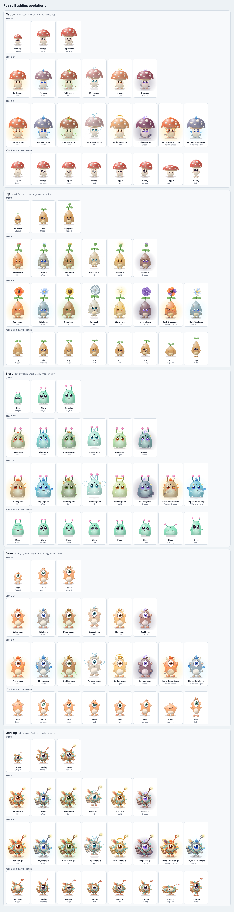

# Fuzzy Buddies

A living, interactive digital companion that makes everyday computer use more playful, surprising, and magical.

Players raise small fuzzy creatures that live in the browser (and later the desktop). Buddies roam, explore page elements as terrain, react to what you do, make expressive noises, and get into physical comedy on their own.

> **Primary directive:** Build one wonderful, funny, curious little digital creature first. Then build the world around it.

## Status

Phase 1: a browser playground with five starter species: Cappy the mushroom, Pip the seed, Blorp the squishy alien, Bean the cuddly cyclops and Oddling the wire tangle. See [docs/ROADMAP.md](docs/ROADMAP.md). Five starter species share one engine, each growing through five stages. Stages IV and V take an element (Fire, Water, Earth, Air, Light, Shadow) from what you feed them. Pick a species and watch it grow in the playground panel, or open `/sheet.html` in dev for every form.



## Run it

```bash
npm install
npm run dev     # open http://localhost:5173 and meet the buddies
npm test        # headless creature simulation tests
node scripts/build-single.mjs puff.html   # one self-contained playable file
```

## Layout

```
src/
  core/        creature engine, DOM-free: state, behavior, physics, events, audio cues, effects
  browser/     host adapter: page surfaces, pointer, typing, drag-and-drop, Web Audio, storage
  rendering/   procedural Canvas 2D renderer
  ui/          playground inspector panel
tests/         unit tests and headless simulations
docs/          vision, roadmap, architecture, game design, ADRs
```

## Docs

| Doc | What it covers |
| --- | --- |
| [VISION.md](docs/VISION.md) | The full product vision and development brief (source of truth for scope) |
| [ROADMAP.md](docs/ROADMAP.md) | Phases and the current milestone |
| [ARCHITECTURE.md](docs/ARCHITECTURE.md) | Engine layout, the core/adapter boundary, event schema |
| [GAME_DESIGN.md](docs/GAME_DESIGN.md) | The cast, behaviors, moods, reactions and evolution as built |
| [adr/](docs/adr) | Architecture decision records |
| [direction/](docs/direction) | Notes from the creative team to engineering |
| [concepts/](docs/concepts) | Concept art rounds and art decisions |

## Roles

- **Creative Director (Derek):** creative vision, priorities, final approval
- **Creative Co-Director:** ChatGPT (OpenAI), via notes in [docs/direction](docs/direction)
- **Producer / Game Design:** ChatGPT
- **Engineering Lead:** Claude
- **Architecture Review:** ChatGPT

Major changes to vision or scope need Director approval before merge.
