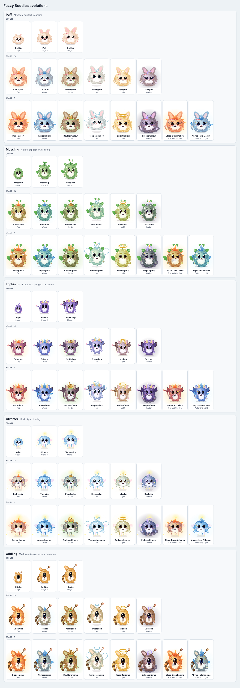

# Game Design: Puff, as built

This records what the playground actually does, so design discussion starts from reality. The Producer owns this doc. Engineering keeps it in sync with code.

## Starter species

Five species share every behavior, reaction and physics rule. Only the body differs, defined as data in `src/core/creature/species.ts` and assembled from parts in `src/rendering/parts.ts`. Switch species from the playground panel. Review art on the lineup (`npm run dev`, then open `/sheet.html`).

| Species | Theme | Silhouette |
| --- | --- | --- |
| Puff | Affection, comfort, bouncing | Peach marshmallow cloud, long floppy bunny ears, cotton tail, freckles |
| Mossling | Nature, exploration, climbing | Mossy green ball, leaf ears, sprout on top, tiny flowers, leaf tail |
| Impkin | Mischief, tricks, energetic movement | Small plum egg, bat ears, cream horns, heart-tipped tail, one fang |
| Glimmer | Music, light, floating | Sky-blue fluff that hovers and glows, side fins, star antenna, twinkling freckles, sparkle wisp |
| Oddling | Mystery, mimicry, unusual movement | Mustard fluff, one big eye and single brow, one floppy ear and one curly antenna, ringed tail, belly swirl |

## Species personalities

Same engine, different bodies and temperaments. Personality comes from multipliers on behavior scores, plus walk speed, hop height and gait.

| Species | Silhouette | Gait | Speed / hop | Loves | Avoids |
| --- | --- | --- | --- | --- | --- |
| Puff | Wide, squat marshmallow | Waddle (side-to-side tilt) | 0.8 / 0.9 | Cuddles, belly flops, naps | Exploring, chasing |
| Mossling | Tall acorn, narrow top | Steady stride | 0.85 / 1.0 | Peeking over edges, leaping to ledges, investigating | Dancing |
| Impkin | Small egg, bat wings from Stage III | Bouncy scamper | 1.4 / 1.35 | Chasing your cursor, hopping | Naps, cuddles, grooming |
| Glimmer | Dome that hovers, ribbon tendrils for feet | Floats | 0.9 / 0.8 | Dancing, idling | Hopping, flopping |
| Oddling | Tall wobbly bean, one eye | Wobble | 1.0 / 1.1 | Investigating, stretching | Cuddles |

## Growth and evolution

### Stages

| Stage | Size | What changes |
| --- | --- | --- |
| I | 74% | Baby: big eyes, tiny ears, nub horns, no markings |
| II | 100% | The species as designed |
| III | 110% | Stage III flourish: Puff gets a bow, Mossling's sprout blooms, Impkin grows bat wings, a star orbits Glimmer, Oddling gets spots |
| IV | 118% | Takes an element: fur tint, iris color, head crest, body marks, aura, ambient particles |
| V | 128% | Deepens the element with a mantle behind the body, or blends in a second element's marks and particles |

### Elements

Fed words are classified locally: a word list first, then a fallback from the word's affinity (nature to Earth, mystery to Shadow, and so on). Every bite shows a `+Fire` style bubble.

| Element | Crest | Marks | Particles | Stage V mantle |
| --- | --- | --- | --- | --- |
| Fire | Three flickering flames | Flame licks on the sides | Rising embers | Flame mane |
| Water | Droplet crest | Wave lines | Bubbles | Dorsal and side fins |
| Earth | Amber crystals with moss | Pebbles | Orbiting leaves and stones | Crystal shards on the back |
| Air | Feather plumes | Wind swirls | Circling wind streaks | Feathered wings, and it floats |
| Light | Halo | Star marks | Twinkling sparkles | Sunburst rays |
| Shadow | Crescent moon | Crescents | Drifting smoke | Smoky cape |

### Rules (prototype tuning)

- **Growth points** come from varied moments: pets 4, snacks 5, new discoveries 8, cuddles 4, naps 3, climbs 3, and smaller amounts for others. Repeating the same moment within a minute halves its value each time, so clicking cannot farm growth.
- **Thresholds:** 40 to Stage II, 110 to III, 220 to IV, 380 to V. These are sized for minutes of play; the real game should stretch IV and V across weeks.
- **Stage IV** needs at least 3 element points and takes the strongest element.
- **Stage V** needs at least 4 element points fed since Stage IV. If a second element reached 60% of the Stage IV element in that time (and at least 2), the form blends; otherwise it deepens.
- Evolution waits until the buddy is standing and free, then plays a glow, shake and burst. If you poke or grab it mid-evolution, the new body still arrives.
- Switching species in the playground keeps stage and elements, so you can compare one form across species.

### Names

Stages I to III have species names (Puffbit, Puff, Pufflop). Stage IV and V combine an element prefix with a species stem: Emberpuff, Blazemallow, Pebblemoss, Bouldergrove. Blends hyphenate both elements: Blaze-Dusk Mallow.

## Look: plush toy

All species are drawn as soft collectible plushes. Everything is procedural (Canvas 2D), so tweaks are code changes.

- **Body:** radial shading with a rim light, felt texture, surface fuzz, and two layers of rounded fur clumps around the edge
- **Details:** stitched belly patch, a little fabric tag on the side seam, felt cheeks
- **Ears and tail:** soft cat-like ears with pink insides, and a pom-pom tail. Both are on springs
- **Feet:** stubby mitten feet with toe beans that show whenever a sole turns toward you (sitting, kicking, dangling, belly flops)
- **Face:** glossy bead eyes with fixed highlights and a drifting pupil, eyelids that blink and set mood, felt eyebrows, a heart nose, and a `:3` mouth by default

### Expressions (13)

neutral, happy, curious, surprised, panic (with sweat drop), angry, sad (with tears), smug, sleepy, sleep, dizzy, chew, hungry. A random **blep** (tongue out) can appear while Puff is calm.

### Rig and secondary motion

| Part | Driven by |
| --- | --- |
| Ears | Expression target (perk when surprised, droop when sad or sleepy, pinned back when angry), lift while falling, flop when held, random twitches |
| Tail | Wags when happy or hugging, flicks when angry, wraps around the body when curled up, swings with acceleration |
| Arms | Lag behind body motion, then settle |
| Lean | Into walking direction, over the edge when peeking |
| Breathing | Constant gentle swell, slower while asleep |
| Face | Features slide toward where Puff is looking, which reads as a head turn |

### Poses

stand, sit (after about a second of idling), curl (napping), flop (belly flop), peek (over a ledge), hug (reaching for a resting cursor).

## Mood

Four values from 0 to 1 that drift over time and shift with events.

| Mood | Drifts | Raised by | Lowered by |
| --- | --- | --- | --- |
| Energy | Down slowly, faster while walking or airborne | Napping | Hops, leaps, dancing |
| Curiosity | Up slowly | Tech and mystery snacks | Reaching a ledge, inspecting |
| Playfulness | Up slowly | Pokes, music snacks | Chasing, dancing |
| Comfort | Down slowly | Petting, grooming, nature, food and emotion snacks | Repeated pokes, rude awakenings |

## Autonomous behaviors

| Behavior | Score (before repeat penalty and noise) | What happens |
| --- | --- | --- |
| Idle | 0.28 | Looks around, turns |
| Wander | 0.22 + 0.35 × curiosity × energy | Walks, usually staying on its ledge. Sometimes walks off and falls |
| Hop | 0.08 + 0.45 × playful × energy | 1 to 3 hops, 12% chance to trip and tumble |
| Explore | 0.15 + 0.6 × curiosity × (0.4 + energy) if a ledge is reachable | Crouches and leaps. Lands, hangs from the edge (60% pulls up), or falls short dazed |
| Chase | 0.18 + 0.7 × playful while the cursor moves | Runs after the cursor and pounces when it is just above |
| Nap | 1.6 × (1 − energy)^1.6 | Yawns, curls up, z's, hums. Wakes and stretches when rested |
| Inspect | 0.14 + 0.55 × curiosity (Dynamic mode) | Walks to the nearest element, ponders, and reads one word from it |
| Dance | 0.04 + 0.55 × playful × energy × (0.5 + comfort) | Bounces, sways, sings notes |
| Groom | 0.06 + 0.4 × (1 − comfort) | Fluffs and shakes its fur |
| Stretch | 0.07 × energy, or after napping | Tall stretch and a yawn |
| Belly flop | 0.04 + 0.35 × comfort × playful | Flops flat with feet kicking in the air |
| Peek | 0.08 + 0.45 × curiosity × (0.6 + energy), on a ledge | Walks to the edge and leans over to look down. 18% chance it leans too far and falls |
| Cuddle | 0.45 + 0.6 × comfort when the cursor rests just above it | Walks under the cursor and hugs it, purring with hearts |

## Interrupts

| Trigger | Reaction |
| --- | --- |
| Click | Squash, squeak, sometimes a hop. 4 pokes within 3 s makes it grumpy, 7 makes it sit down and cry with its back turned. Poking a sleeping Puff earns a rude awakening |
| Rub without clicking | Purr, hearts, blush |
| Press and drag | Dangles, legs kick. Release over 1000 px/s is a toss |
| Very fast cursor nearby | Startled leap away |
| Focus or typing in a field within 150 px, or on the field Puff is sitting on | Panicked escape leap. Typing is never blocked |
| Its platform moves (scroll) | Wobbles. A jump of more than 24 px in one frame may knock it off |
| Hard landing (not tumbling) | 35% chance of a happy belly flop |
| Landing after a tumble | 55% upside down with leg flailing, then flips back angry. Otherwise dazed |
| Hitting a wall fast | Bonk and dizzy on landing |

## Snacks

Words are classified locally into affinities: nature, food, music, technology, weather, emotion, fantasy, mystery.

| Affinity | Reaction |
| --- | --- |
| Nature, food | Delighted hop, hearts (Puff's favorites) |
| Music | Starts dancing |
| Technology | Curious bleeps |
| Weather | Thunder and storms scare it. Gentle weather is fine |
| Emotion | Lots of hearts, purring |
| Fantasy | Sparkles and a fanfare |
| Mystery | Big question mark, more curious |
| Unknown | 45% spits it out, otherwise "hm" |
| 3+ words or over 18 characters | Burp |

## Discoveries (26)

Poke, purring pet, picked up, big toss, typing escape, shaken off by scrolling, ledge hang, pull-up, botched leap, tripped mid-hop, wall bonk, unexpected nap, rude awakening, dance break, first snack, spat it out, big bite, read the page, cursor chase, too fast, upside-down landing, belly flop, peeking over the edge, cursor cuddle, sulking, blep.

## Open design questions for the Director

1. Which starter should be the hero we polish first?
2. Can a buddy ever change its element after Stage IV (re-evolve, or a rare stone), or is it permanent?
3. Should the element also change behavior (Fire forms more energetic, Shadow forms more nocturnal), not just looks?
4. How long should real Stage IV and V take: days, or weeks?
5. Should Puff ever leave the viewport on its own (walk off screen and come back)?
6. How often may it make noise unprompted before it feels like too much?
